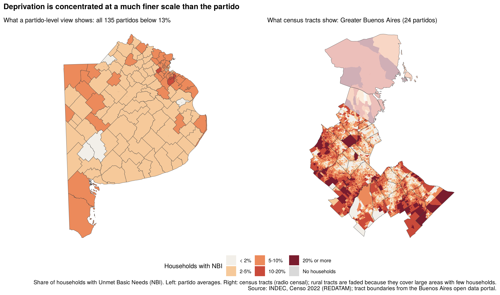
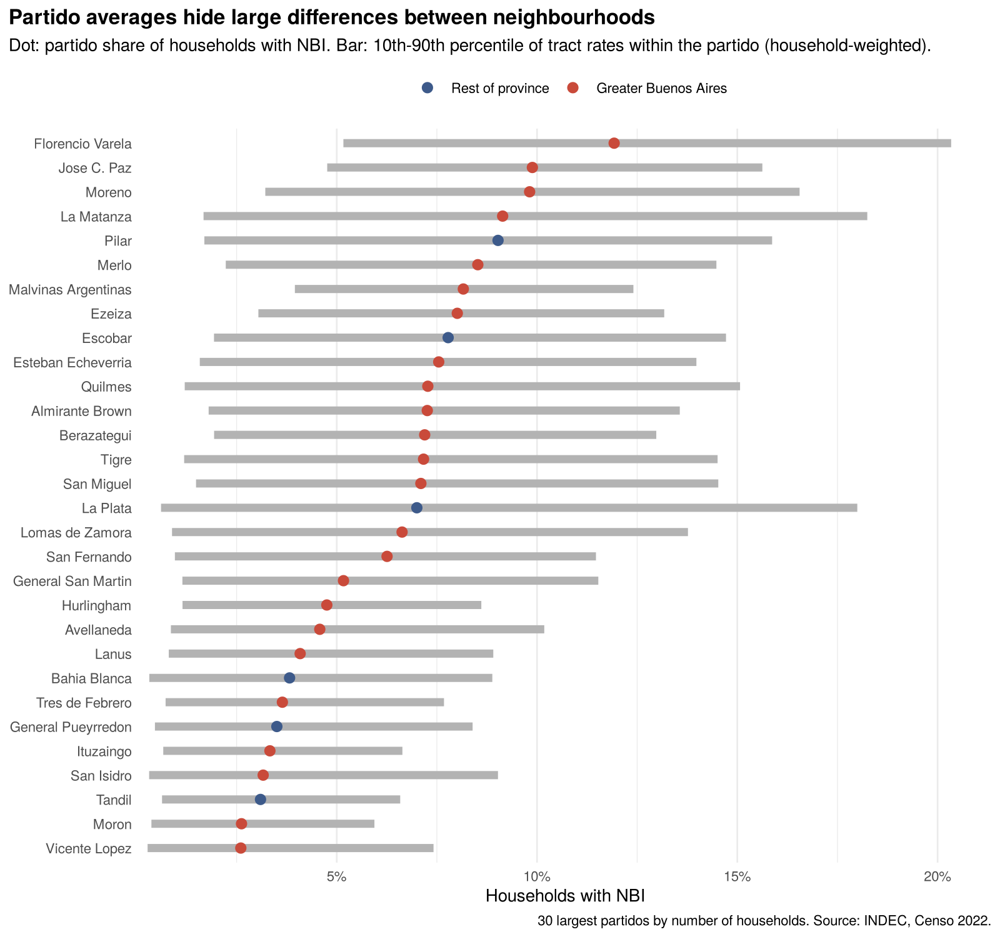
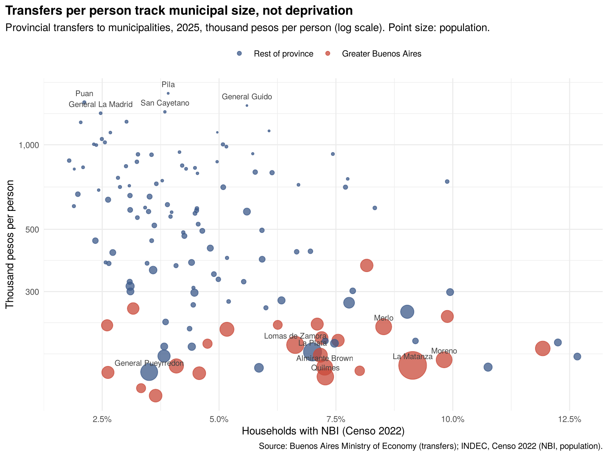
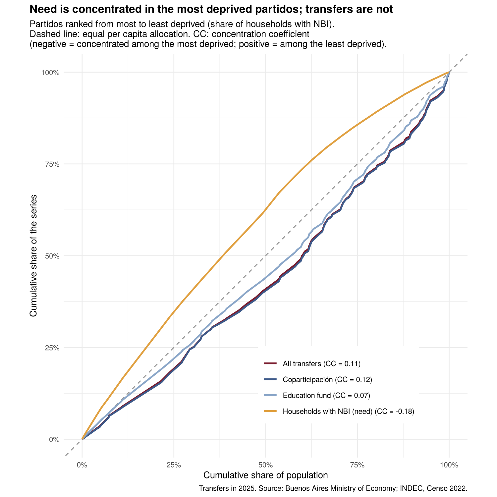
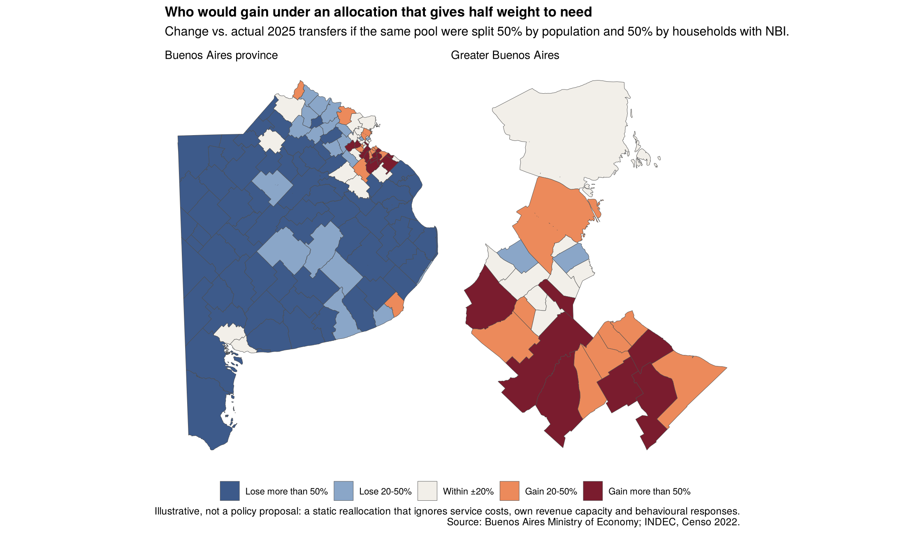
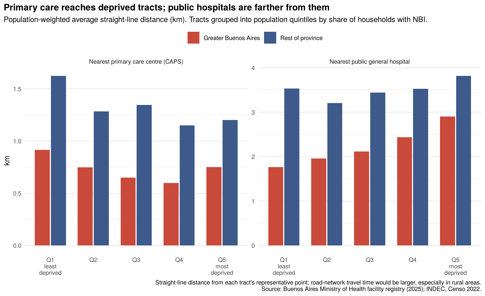
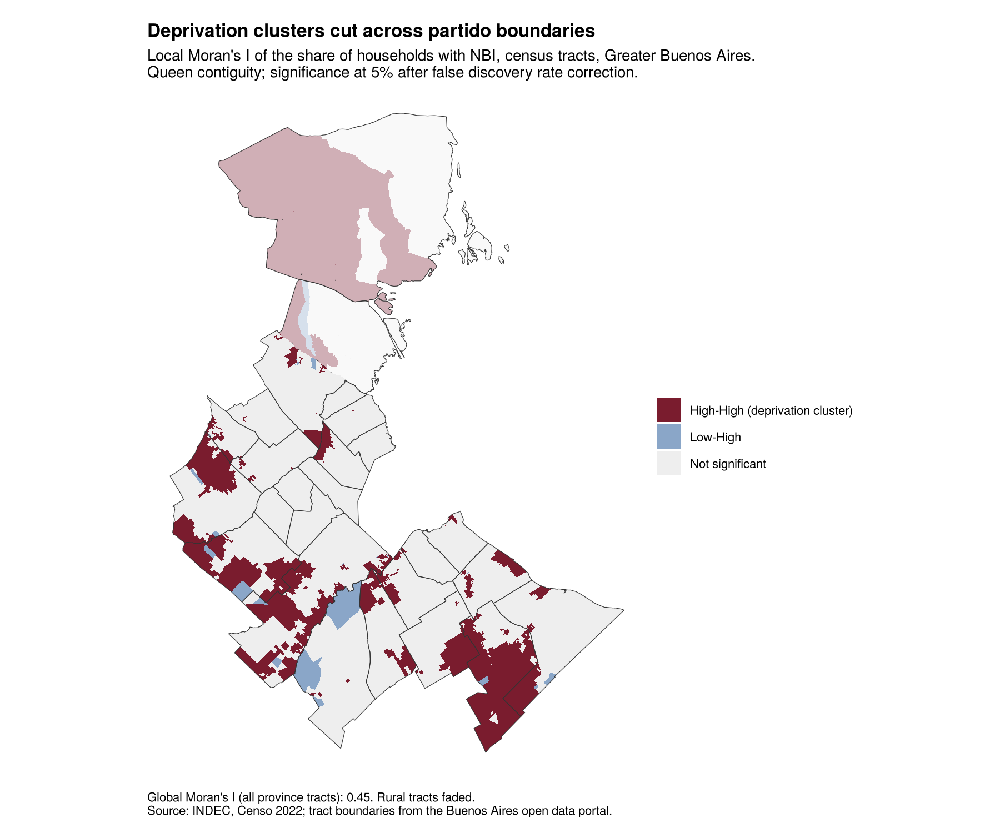

# Do provincial transfers follow need? Buenos Aires municipalities

Work in progress. A spatial look at how the Province of Buenos Aires distributes resources to its 135 municipalities (partidos), compared with where structural deprivation is concentrated at census-tract level (*radio censal*, INDEC's smallest census unit, about 250 households on average in Buenos Aires).

## Data

| Source | Content | Level | File |
|---|---|---|---|
| INDEC, Censo Nacional de Población, Hogares y Viviendas 2022 (REDATAM, base CPV2022, *Lista de áreas*) | Households by Unmet Basic Needs (NBI) status | Census tract | `data/raw/NBI_tot_BA_2022.xlsx` |
| Same | Population in private dwellings, by sex | Census tract | `data/raw/Pop_Total_BA_2022.xlsx` |
| Same | Households by Material Deprivation Index (IPMH) | Census tract | `data/raw/IPMH_BA_2022.xlsx` |
| Province of Buenos Aires open data portal, *Radios censales* (CC BY 4.0) | Census tract boundaries, 2022 | Census tract | `data/raw/radios-censales-2022-shp.zip` |
| Province of Buenos Aires open data portal, *Transferencias a municipios* (CC BY 4.0), Ministry of Economy | Monthly transfers to municipalities by concept, Jan 2010 – Jul 2026 | Partido | `data/raw/transferencias-municipios-012010_072026.csv` |
| Province of Buenos Aires open data portal, *Establecimientos de salud* (CC BY 4.0), Ministry of Health | Public health facilities with coordinates, type and dependency, 2025 | Point | `data/raw/establecimientos_salud_publicos-2025.csv` |

NBI follows INDEC's definition: a household is NBI if it has at least one of overcrowding (more than three people per room), inadequate housing, no toilet, a child aged 6–12 not attending school, or low subsistence capacity. It is a structural deprivation measure, not income poverty.

IPMH (Índice de Privación Material de los Hogares) classifies households by deprivation of current resources (an income proxy) and of patrimonial resources (housing quality). The share of households with current-resource deprivation (current-only plus convergent) is used as a second, closer-to-income measure of need.

## Code

| Script | Does |
|---|---|
| `R/01_clean_census.R` | Reads the REDATAM exports, restores 9-digit census tract (radio) codes, joins households, population and IPMH, writes `data/processed/census_radios.csv` |

| `R/02_geography.R` | Joins tract boundaries to census data, builds partido aggregates, and decomposes tract-level variation in deprivation into within- and between-partido components |
| `R/03_maps_need.R` | Figure 1 (partido vs. tract-level NBI) and Figure 2 (spread of tract NBI rates within partidos) |
| `R/04_transfers.R` | 2025 transfers per capita by partido, concentration curves with respect to need, size-controlled regression, and a needs-based counterfactual allocation (Figures 3–5) |
| `R/05_access.R` | Straight-line distance from each tract to the nearest public general hospital and primary care centre, by deprivation quintile; hospital provision and transfers (Figure 6) |
| `R/06_spatial_dependence.R` | Global and local Moran's I of deprivation (tracts) and transfers per capita (partidos); robustness of the within-partido share to excluding small tracts (Figure 7) |

Run the scripts in order from the repository root, e.g. `Rscript R/01_clean_census.R`.

## First results

Most of the variation in deprivation is **within** partidos, not between them. Weighting by households, 83% of the variance in tract NBI rates and 77% for IPMH current-resource deprivation lies within partidos. Any allocation rule that works with partido averages misses most of where need is. The share is stable when small, noisy tracts are excluded (82% with tracts of 50+ households, 81% with 200+).

### Transfers and need

In 2025 the province transferred about 4.35 trillion pesos to municipalities; coparticipación (Ley 10.559) was 77% of it.

- **Transfers are not concentrated where need is.** Ranking partidos from most to least deprived, households with NBI have a concentration coefficient of −0.18, while transfers have +0.11 (coparticipación +0.12). Greater Buenos Aires receives about 190,000 pesos per person against 348,000 in the rest of the province, despite a higher NBI rate (7.0% vs 5.4%). The pattern holds, more weakly, when need is measured with IPMH current-resource deprivation (+0.05).
- **Size, not need, explains per capita transfers.** A 1% larger population is associated with about 0.4% lower transfers per person, and size alone explains most of the variation (R² rises from 0.20 to 0.75 when it is added). Once size is controlled for, the association with NBI is small and not significant at 5%. Transfers do not respond to need in either direction; they follow scale.
- **Reallocating with half weight on need would shift resources sharply.** Splitting the same pool 50% by population and 50% by NBI households would raise transfers by more than 20% in 24 partidos, mostly in Greater Buenos Aires, and cut them by more than 20% in 92. This is an illustration of how far current allocation is from need, not a proposal: it ignores the fixed costs of small municipalities, the services (notably hospitals) that the current formula rewards, and own revenue capacity.

### Access to public health facilities

Using the 2025 registry of public facilities (290 general hospitals with inpatient care, 2,121 primary care centres), I computed the straight-line distance from each census tract to the nearest facility and averaged it by population across deprivation quintiles.

- **Primary care is placed where need is; hospitals are not.** In Greater Buenos Aires, the distance to the nearest primary care centre is shortest in the more deprived tracts, but the distance to a public general hospital rises steadily with deprivation, from 1.8 km in the least deprived quintile to 2.9 km in the most deprived. 10.8% of people in the most deprived quintile live more than 5 km from a public general hospital, against 1.5% in the least deprived.
- **Hospital provision is what the transfer formula rewards.** Partidos with more public hospitals per capita receive more per person, even after controlling for size and deprivation (elasticity about 0.28; R² 0.79). Under Ley 10.559, 37% of the coparticipación coefficient is distributed on health indicators: available beds, consultations, patient-days, discharges and facilities with inpatient care ([CREEBBA, IAE 161](https://m.creebba.org.ar/iae/iae161/1_coparticipacion_IAE_161.pdf); [Ley 10.559](https://intranet.hcdiputados-ba.gov.ar/refleg/lw10559.pdf)). Transfers therefore follow where hospitals already are, which is not where deprivation is concentrated.

Distances are straight-line from each tract's representative point; travel times over the road network would be longer, especially in rural tracts. Facilities are 2025 and population 2022.

### Spatial clustering

Deprivation is strongly clustered: the global Moran's I of tract NBI rates is 0.45 (0.49 for IPMH current-resource deprivation; queen contiguity, row-standardised weights). Local Moran's I identifies 1,261 tracts in significant high-deprivation clusters after correcting for multiple testing (false discovery rate, 5%). In Greater Buenos Aires these clusters form belts along the western and southern edge of the conurbano that span several partidos, so no single municipality's budget lines up with them. At partido level, transfers per capita are also spatially clustered (Moran's I 0.64), reflecting the rural-interior versus conurbano divide.

## Requirements

R (≥ 4.3) with `readxl`, `readr`, `dplyr`, `tidyr`, `sf`, `spdep`, `ggplot2`, `patchwork`, `scales`.
